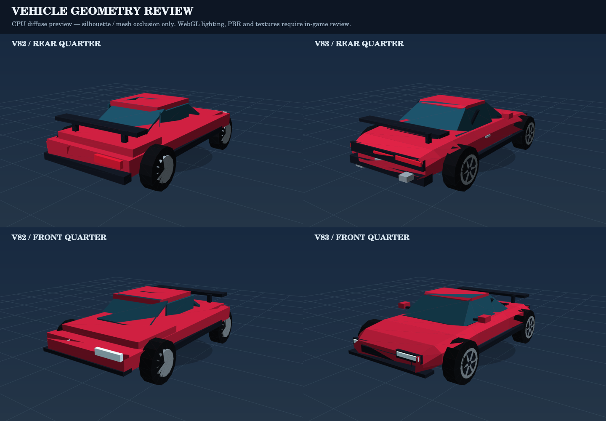

# V83 — Sculpted player coupe

Replace the player's stacked rectangular body volumes with a single authored,
closed eight-section chamfered shell. A sloped glazing envelope and tapered roof
meet the body deck. Existing nose/trunk semantic anchors and steering/spin pivots
retain their positions so heading checks, effects and pose animation keep working.

Chase-camera details now include recessed tail lamps, center light bridge, deck
vents, diffuser, plate, exhaust outlets and lower wing supports. Front intakes,
mirrors and six-spoke wheels complete the silhouette during drifts. Spokes and rim
rings share one buffer geometry across all four wheels. Lower paint metalness
retains more base color without requiring an external environment map.

A 64×128 analytic alpha texture replaces the hard rectangular contact shadow.
It remains aligned to the road, and is disposed with the model. LOW quality hides
spokes, mirrors, handles and deck vents; higher quality restores them. No new lights,
postprocessing passes, asset downloads or per-frame geometry allocations are added.

## Evidence

- 1,252 model triangles and 49 mesh nodes; with flames off: 47 visible meshes in
  HIGH, 33 in LOW. Counts describe this player model, not the complete frame.
- One additional 32 KiB CPU RGBA texture (GPU/mipmap overhead excluded).
- Real Three.js tests verify finite unit normals, a closed oriented body shell,
  symmetric bounds, the existing silhouette envelope, alpha falloff, quality
  toggling, geometry reuse over 600 poses and exactly-once resource disposal.
- V81 world-space heading and front-wheel checks remain active.
- The seven seeded 108-frame driving replays compare the V82 HTML baseline
  frame for frame, including position, momentum, yaw, slip, speed and nitro.
- Full `npm test` includes unchanged gameplay checks and the new V83 mesh checks.



This review image is rendered from the actual old/new mesh triangles using
`tools/render-vehicle-review.cjs`, a CPU painter with diffuse shading. It shows
silhouette and overlap; it does not verify WebGL PBR, transparency, actual texture
filtering, game lighting or FPS. Cloud Chromium has WebGL disabled. Player review
of the public V83 build remains necessary for the final appearance.

Reproduce the geometry comparison with a baseline module exported from commit
`c539ada89b3a383695282034c0a88c4c95a5e538` (remote V82):

```sh
git show c539ada89b3a383695282034c0a88c4c95a5e538:src/rendering/Vehicle3D.cjs > /tmp/v82-Vehicle3D.cjs
node tools/render-vehicle-review.cjs docs/reviews/v83/vehicle-geometry.png /tmp/v82-Vehicle3D.cjs
```
