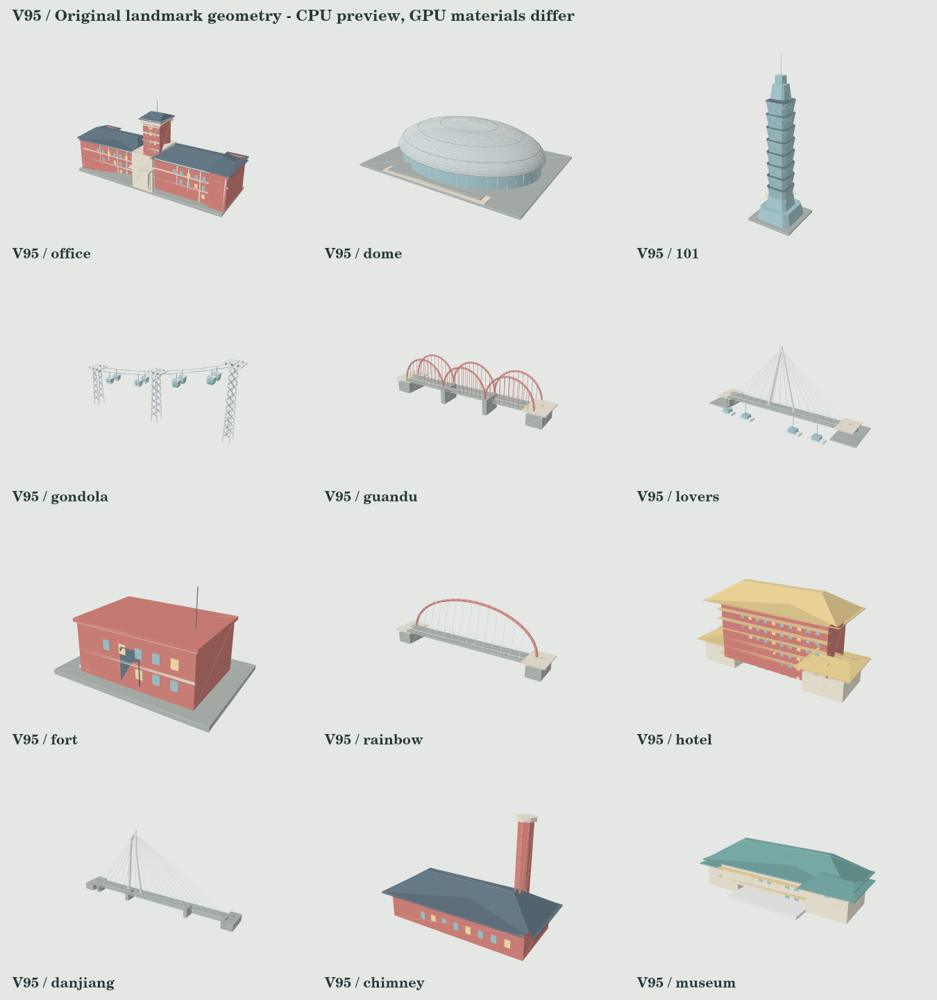

# V95 — Taipei geography and landmark reconstruction

V94 handling, acceleration, race road geometry, collision rules and world speed
remain unchanged. Presentation now uses explicit profiles for all 15 districts,
rather than inferring everything from four broad race archetypes. A byte-level
SHA audit covers the V94 drift/fine-steering physics block; rules namespace is 95.

## District layout

- Songshan/Dome, Xinyi and the civic core have level visual road surfaces, no
  expressway deck and no water. Only visual elevation is adjusted; the underlying
  driving/traffic simulation is preserved.
- Civic Expressway has buildings at ground level below the deck, parallel surface
  roads, piers and a grey urban base. The renderer previously excluded expressway
  buildings entirely, creating a broad empty background.
- Guandu river/wetland scenery occupies the opening of 3A; water narrows out during
  34–52% stage progress, followed by a Beitou spring-town landscape. Springs are
  not presented as an open coastline.
- Tamsui and the harbor have bounded water, a visible opposite bank, small distant
  buildings and hills. Ocean styling is reserved for the Fugui coast. Huandong's
  Keelung River view appears only toward the later Raohe approach.
- The civic corridor is interpreted as northbound Chongqing South Road: Office
  west/left, Jingfu Gate east/right on the same Ketagalan axis, Liberty Square
  southeast. Facades face the carriageway; they no longer all face down the road.
  Landmark announcements now select the nearest upcoming anchor independent of
  catalog order. The compressed race is not a street-navigation/GIS reconstruction.

## Models and materials

28 original independent GLB files are committed in `assets/landmarks`, totaling
about 3.44 MB. The exporter uses the same source geometry as runtime; game loading
continues to use the bundled procedural factory, avoiding extra asset requests.

Rebuilt primary shapes include the Office brick/stone wings and central tower,
101's eight chamfered tapered sections and facade grid, the Dome's elliptical
hemisphere with roof ribs/rings and glazing, Maokong lattice pylons/pulleys/sagging
cables/suspended glazed cabins, and distinct Guandu arches, Rainbow arch, marina
Lovers Bridge and Danjiang cable-stayed river view. Danjiang is a new actual model
rather than a route name without a corresponding landmark. Chinese hipped roofs
and Fort San Domingo's block/parapet silhouette are also corrected.

All models use up to six grouped PBR roles: masonry, glass, metal, roof, warm light
and foliage. Glass/metal roughness and environment response differ from brick and
concrete. No per-window draw calls, extra scene lights or shadow maps are added.
Model clearances account for rotated width and depth, with bridge spans adapted
to river width. Pedestrian bridges remain scenic; cars do not drive across them.

## References used for relationships and observable form

- [Tourism Administration — Presidential Office](https://www.taiwan.net.tw/m1.aspx?id=137&sno=0001090)
- [Songshan Cultural Park — access](https://www.songshanculturalpark.org/service/qa)
- [Taipei traffic engineering — Civic Expressway](https://bote.gov.taipei/News_Content.aspx?n=A2DF89D717DCF17B&s=E7805D50AED38596)
- [Taipei Tourism — Thermal Valley](https://www.travel.taipei/zh-tw/attraction/details/210?fid=9898)
- [New Taipei Tourism — Tamsui waterfront/Lovers Bridge](https://newtaipei.travel/zh-tw/attractions/detail/402693)
- [C.Y. Lee — Taipei 101](https://www.cylee.com/project/Taipei-101?lang=tw)
- [Taipei Dome](https://www.taipeidome.com.tw/Web/dome/)
- [Maokong Gondola — cabins](https://www.gondola.taipei/cp.aspx?n=004537494D1F58B3)
- [Highway Bureau — Danjiang design](https://www.thb.gov.tw/News_Content_table.aspx?n=87&s=57491)

References inform original stylized geometry; no official meshes, logos or photo
textures are redistributed. Relative placement is authored and compressed.

## Geometry preview

## Validation and limits

Tests cover deterministic GLB export parity, binary chunks and valid indices,
material grouping, finite geometry and triangle winding, all district profiles,
river-to-town transitions, dry-city water exclusion, below-deck building grounding,
level Songshan roads, civic axis relationships, rotated fork clearance, allocation
reuse and disposal. CPU projection previews of actual geometry were visually
inspected; these do not reproduce GPU PBR lighting. Full regression covers existing
V55–V94 gameplay. GPU appearance, FPS and subjective scene fidelity still require
an actual playtest; the cloud browser has WebGL disabled.

Validation result: npm test passed 1,241 regression checks and the V55–V95 suites.
After refining the Danjiang pylon, the GLB/winding/geography and all-landmark
clearance suites plus bundle consistency were rerun and passed.
